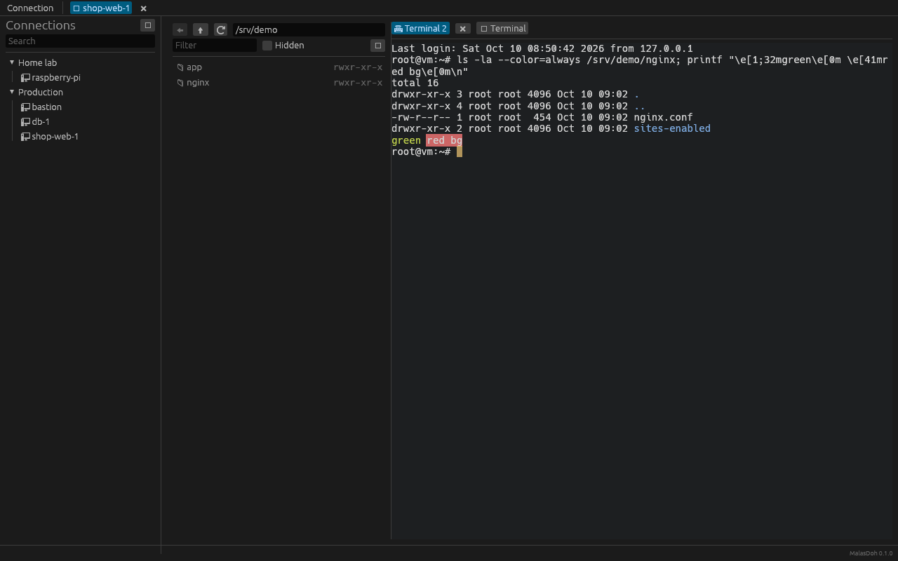

# MalasDoh

A native SSH client for people who log in to servers to patch files and fix
configs. It combines a terminal, an SFTP file browser and an editor in one
window, and it is careful about the one thing that matters most when you edit
a file on a live server: **not breaking it**.

Written in Rust. One binary for Windows, Linux and macOS, with no Electron, no
browser engine and no PuTTY/OpenSSH runtime dependency.



## Why another SSH client

electerm, WinSCP and Termius each do part of this well. MalasDoh focuses on the
remote-editing loop, where they are weakest:

| When you save a remote file… | MalasDoh |
| --- | --- |
| Do you see what you changed? | A diff is shown before writing (can be turned off). |
| Did someone else change it meanwhile (a colleague, Ansible, a deploy)? | The file is re-read first. If it changed, nothing is written; you get their version vs yours, and **if the edits touch different lines you can keep both** (three-way merge). |
| Can you undo it? | The previous contents are always backed up on your computer (optionally also as `file.bak-<time>` on the server). Any backup can be restored, through the same diff review. |
| Does it keep owner, group, mode, hard links, SELinux labels? | Yes. The file is rewritten in place, not replaced. |
| Does it keep CRLF line endings, a BOM, a missing final newline? | Yes, byte for byte on the lines you did not touch. |
| Did the write actually land? | The file is read back after saving and must match. |
| The file is owned by root? | "Edit as root (sudo)", or "Save as root" when a save hits *Permission denied*. |
| Is the config still valid? | Matching files are checked as part of saving: `visudo -c`, `sshd -t`, `nginx -t`, `apachectl configtest`, HAProxy, BIND, systemd units, fstab, Caddy, PostgreSQL, and JSON/TOML/YAML syntax. Checks that must not see a broken file (sudoers) run on a copy first; others run in place and **the original is put back automatically** if the check fails. An optional reload command runs only after a pass. |


## Features

- **Connections**: saved profiles with groups and search; jump hosts
  (ProxyJump) with chains; import from `~/.ssh/config`; duplicate; copy as an
  `ssh` command.
- **Teleport** (Connection → Teleport…): add your cluster by its web address,
  log in with your password and authenticator code, and its servers become
  ordinary connections (terminal, files, editor, saving checks), without
  `tsh` or a browser. The key is made on this computer and Teleport signs it
  for as long as the cluster allows (often 12 hours); the password can be
  kept in the system keychain, the code is asked each time. Once you are
  logged in, every server you may use is listed straight away, with the
  logins allowed on each (asked of Teleport's auth service with your login's
  certificate, as `tsh ls` does, so no second code), and the ones you tick
  are added in a "Teleport · cluster" group. Servers are
  reached through the proxy, on its SSH port or over its web port when the
  cluster serves everything on one port, and trusted through the cluster's
  host CA, so there are no fingerprint questions. When the login runs out,
  connecting asks for it and then carries on. A self-signed proxy can be
  trusted by its fingerprint. Not supported: single sign-on and security-key
  logins, and clusters that want a code for every session
  (`require_session_mfa`); those need `tsh` or the web page.
- **Remote Desktop** (RDP), in your own Remote Desktop program (`mstsc` on
  Windows, FreeRDP or Remmina on Linux), which is what keeps the mouse and
  screen smooth: MalasDoh only carries the connection. A Teleport cluster's
  Windows desktops are listed after logging in, like its servers, and added
  as Remote Desktop connections; opening one finds a server of the cluster
  in your list that reaches the desktop (checked with a real RDP hello,
  since Teleport accepts a forward before trying it), forwards a local port
  through it, and remembers that server for next time. Any connection can
  have one too: **Remote Desktop through this…** on an SSH connection, or
  a Remote Desktop connection reached directly or through its Proxy (the
  built-in WireGuard tunnel included). Closing the Remote Desktop window
  closes the port. FreeRDP has no login window, so MalasDoh asks for the
  Windows password (kept in the keychain if you like) and hands it over on
  its standard input, not its command line. Note that this goes around
  Teleport's own desktop access (and its session recording): it needs a
  server allowed to forward ports, and is worth agreeing with whoever runs
  the cluster.
- **Proxies**: reach the first server through SOCKS5, an HTTP proxy
  (`CONNECT`), or any command (`ProxyCommand`, e.g. `nc -X connect -x
  proxy:3128 %h %p`, imported from `~/.ssh/config`). Proxy passwords are
  asked for and kept only in the OS keychain.
- **Keepalive** per connection (default every 30 s), so idle sessions survive
  NAT and firewalls and a dead link is noticed.
- **Export / import** your connections, snippets and accepted host keys as
  one file encrypted with a passphrase (PBKDF2-SHA256 + ChaCha20-Poly1305),
  to back up or move to another computer. Importing only adds what is new.
- **Port forwarding**: local (`-L`), remote (`-R`) and SOCKS5 (`-D`), saved per
  connection or added for one session, started with the connection if you
  like, and restarted after a reconnect, with live connection and byte counts.
- **Authentication**: SSH agent (OpenSSH agent and Pageant on Windows,
  `SSH_AUTH_SOCK` elsewhere), key files (OpenSSH, PEM, **PuTTY `.ppk`**,
  encrypted or not), password and keyboard-interactive (including OTP prompts).
  Passwords, key passphrases and sudo passwords are only stored if you tick
  "remember", and then in the OS keychain (Windows Credential Manager, macOS
  Keychain, Secret Service), never in MalasDoh's files. A saved sudo password
  that stops working is forgotten and you are asked again (not retried, since
  failed sudo attempts are logged and can lock the account). Per connection
  you can also let sudo try the saved login password first.
- **Host keys**: checked against your existing `~/.ssh/known_hosts` (so hosts
  you trust in `ssh` are trusted here) and MalasDoh's own file. A new host shows
  its SHA256 fingerprint for you to confirm. A *changed* or `@revoked` key is
  refused outright and never offered as "accept anyway". Host certificates
  signed by a `@cert-authority` you trust are accepted without a prompt.
- **SSH keys** (Tools → SSH keys): make an Ed25519 key (with a passphrase if
  you like), put any key on a server like `ssh-copy-id` does (owner-only
  permissions, never added twice), then switch the connection to log in with
  it. **Paste a key…** keeps a private key without a file (from a password
  manager such as Proton Pass, say): OpenSSH, PEM or PuTTY format, checked
  when pasted, its passphrase asked once and taken off, and kept in the
  system keychain (on a computer without one, in the owner-only settings
  file, and the window says so). Choose it on a connection as
  **Authentication → Stored key**; its public key can be copied or put on a
  server from the same window, and an OpenSSH certificate for it can be
  pasted too.
- **Import** connections from `~/.ssh/config`, PuTTY (registry on Windows,
  `~/.putty/sessions` elsewhere) and WinSCP (registry or `WinSCP.ini`, with
  its folders). Saved passwords are not imported.
- **Certificates for you**: `id_ed25519-cert.pub` next to your key, a
  certificate in your agent, or one pasted with a stored key, is used
  automatically.
- **Terminal**: xterm-256color and truecolor, full-screen programs (vim, nano,
  htop, less), scrollback, selection and copy, bracketed paste, several
  terminals per connection. Ctrl+C copies when text is selected and interrupts
  otherwise. Search the scrollback (Ctrl+Shift+F), and log a terminal to a
  plain-text file. Colour themes (Tomorrow Night, Solarized dark and light,
  Dracula, Gruvbox, Light) and your own monospace font file. Right click
  copies a selection or pastes, middle click pastes, copy-on-select if you
  like; pasting several lines into a shell asks first. Ctrl+click opens
  links. Programs that use the mouse (htop, mc, vim) get it; Shift+drag still
  selects.
- **Split**: two panes side by side, any mix of terminals, files and logs.
- **Type into several terminals** (Tools): what you type goes to the servers
  you tick, under a red bar so it is never on by accident.
- **Agent forwarding** per connection (`ssh -A`), off by default, never to
  jump hosts; agent requests from servers without it are refused.
- **File browser**: navigate, filter, hidden files, upload (button or drag and
  drop from the desktop) and download (files or whole folders, with progress and
  cancel), new file/folder, rename, delete, chmod, copy path, "cd here in
  terminal". Nothing is overwritten without asking first. Selecting works as
  in Explorer, in both the server's list and your computer's: Ctrl+click,
  Shift+click for a range, Ctrl+A for all; once you have clicked in a list,
  ↑/↓, Home/End and Page Up/Down move (Shift extends), typing a name's first
  letters jumps to it, Enter opens, Delete deletes (after the usual
  question), F2 renames, Ctrl+C copies the paths, Ctrl+Shift+N makes a
  folder, Backspace or Alt+↑ goes up, Alt+←/→ go back and forward, F5
  refreshes, Ctrl+L and Ctrl+F jump to the path and filter boxes, Shift+F10
  opens the right-click menu and Esc clears. Sort by name, size
  or date; bookmark folders per connection; change owner (`chown`, with sudo)
  and create symlinks; pack a selection into `.tar.gz`/`.tar.xz`/`.zip` and
  unpack archives into a new folder (never over existing files).
- **Browse as root**: the "root" button in the file browser switches it to
  SFTP through sudo (the server's own `sftp-server`), so folders like
  `/etc/ssl/private` or `/root` can be listed, transferred and edited. A red
  badge shows it is on; files opened then are edited as root, with checks
  run as root too.
- **Apply a patch** (`+ New → Apply a patch…`): paste or open a `diff -u` /
  `git diff`, choose the folder it is relative to (and `-p`-style strip), and
  Check: every file is read and every change must match exactly (it may have
  moved, but no fuzz). You see each file's diff; nothing is written unless all
  match, and then each file is saved like an edit (conflict check, backup,
  config check, journal), stopping at the first that fails. New files are
  created; deleting files is left to you. Applying twice does nothing.
- **Find files**: by name pattern and/or text inside, from any folder, as
  root if needed; click a result to show it, double-click to edit.
- **Follow a log** (`tail -F`, also as root): new lines stream in, with a
  filter, pause, errors and warnings coloured, and it keeps going across log
  rotation. Closing the tab stops `tail` on the server.
- **Two panes**: "Local files" puts this computer's folders next to the
  server's, WinSCP style; drag either way, or use the Upload button. Its
  right-click menu (or F2 and Delete) renames and deletes your own files:
  Delete moves them to the Recycle Bin (the Trash on Linux and macOS), or
  for good if you choose so; a rename never replaces another file.
- **Keyboard**: F1 (or Tools → Keyboard shortcuts) lists every key.
  Ctrl+Tab and Ctrl+Shift+Tab switch connections, Ctrl+PgUp/PgDn switch
  terminal and file tabs, Ctrl+Shift+T opens a terminal and Ctrl+Shift+W
  closes the tab. Ctrl+K (or Ctrl+Shift+P) jumps to the connection search:
  type part of a name and Enter connects, or ↓ goes into the list, where the
  arrows, letters, Enter, F2 (edit) and Delete work. Ctrl+N is a new
  connection. Plain Ctrl+letter keys stay with the terminal while you type
  in it (Ctrl+K and Ctrl+N mean something to the shell); the Ctrl+Shift
  ones work everywhere.
  In dialogs Enter presses the main button (OK, Save, Rename, Delete…) and
  Esc cancels; in a box where Enter starts a new line (pasting a key,
  editing a WireGuard configuration) it is Ctrl+Enter. The host key
  question has no Enter on purpose: you choose with the mouse. Esc also
  closes the window you are using (SSH keys, Teleport, Find files…).
  The transfer list takes Delete (cancel) and Space (pause or continue) on
  the rows you click, the host list of "Run on many hosts" takes Space and
  Ctrl+A, and Find files results open with Enter.
- **Copy between servers**: send files or folders from one connected server to
  another (they pass through a private temporary folder on your computer, so the
  servers do not need to reach each other).
- **Compare files**: a file against the same (or any) path on another server, a
  file on your computer, or one of its backups; or two selected files. Context
  of 3 or 10 lines or the whole file, swap sides, copy as a patch.
- **Change journal** (Tools → Change journal): every file you save, when, on
  which server, what changed (as a patch), and how the config check went,
  including saves that were rolled back. Search it by server, path or changed
  text, and compare any save's backup with the server's file now. "Change
  history…" on a file shows just that file.
- **Transfer queue**: each upload or download is one row with files done,
  speed and time left. Several files are copied at once (4 by default, set in
  Settings → Transfers), which is what makes SFTP fast over a slow link:
  over a 50 ms round trip, 60 small files take 3.3 s instead of 16.5 s.
  Pause and continue; a dropped connection continues by itself after
  reconnecting; Retry copies only the files that failed. An interrupted file
  continues where it stopped, after checking its start and end still match
  the source. Nobody sees half a file: downloads and new uploads are written
  as `name.malasdoh-part` and renamed when complete (files already on the
  server are written in place, keeping their owner and permissions, as when
  editing). Modification times are kept both ways. Afterwards each file's
  SHA-256 is compared, computed on the server with `sha256sum` (or `shasum`),
  so nothing is downloaded again. Folder transfers can leave out names or
  patterns (`node_modules, *.tmp`).
- **Replacing files is reviewed first**: when an upload or download would
  replace files (inside folders too), "Replace files?" lists them with their
  sizes and times, marks the ones with the same contents (compared by
  SHA-256, on the server for its copies) so they are not copied again, and
  shows the changes of a text file side by side. Untick any file to keep it
  as it is. Before an upload replaces a file on the server, its copy is
  backed up with the editor's backups (up to 20 MB each; Backups… on the
  file shows them), and text files go into the change journal with what
  changed. Folder sync does the same: Show changes on a row that overwrites
  a file, and backups of server files before they are replaced or deleted.
- **WireGuard, built in** (Connection → WireGuard…), like wireproxy: import
  the `.conf` you would give WireGuard and set a connection's Proxy to it.
  MalasDoh runs the tunnel itself, so nothing is installed and no admin rights
  are needed, and only connections set to use it go through it. Several
  configurations can be in use at once, one per connection. Its private
  key goes to the system keychain (on a computer without one, it stays in the
  owner-only settings file, and the window says so). Connections using the
  same configuration share one tunnel, which ends with the last of them.
  Names are looked up with the tunnel's `DNS =` servers, so internal names
  work. Several peers are routed by their AllowedIPs. Tested against the
  official wireguard-go server: about 35 MB/s on a fast link, and 1–1.5 MB/s
  over one with 50 ms of latency and 2% packet loss. **Test** (also run by
  itself right after Import) checks the server's address, the handshake and
  traffic through the tunnel, and optionally a `host:port` behind it, and
  says which step failed and the likely reason: nothing listening on the UDP
  port, no answer (UDP blocked, server down, or a key mismatch), or a
  server that does not pass traffic on, or (when you connect to the
  WireGuard server's own public address through it) that the server is
  reached at its tunnel address instead. Right-click a group → **Use
  WireGuard for all** sets every connection in it at once (those that start
  at a jump host or log in with Teleport are left alone, and it says so).
  **Edit…** changes a configuration in place (say, one more AllowedIPs
  entry, or a new .conf from your admin), so the connections using it keep
  using it: the private key is never shown, the text is checked before it
  replaces a working one, and it is tested again after saving.
- **Compression** per connection (`ssh -C`), for text and logs over slow
  links.
- **Folder compare and sync**: local to server, server to local, or both ways
  (newer wins), by size and time and optionally contents (by SHA-256 on the
  server, so files are not downloaded to compare). You see every copy and
  deletion first and can untick any of them; deletes are opt-in. Copies go
  through the transfer queue's engine: several at once, times kept, checked
  by checksum.
- **Servers without SFTP** (busybox, dropbear, routers, appliances): files go
  through plain shell commands instead, and everything above still works.
- **Editor**: syntax highlighting for nginx/Apache/sshd-style configs,
  INI/systemd/TOML, YAML, JSON, shell, `.env`, XML and Dockerfiles; line
  numbers with a gutter marking lines added, changed or removed since the file
  was opened (hover a mark to see what was there), auto-indent (a closing `}`, `]` or `)` lines up with its opener, and Enter between a pair opens it up), Tab/Shift+Tab on selections, find and replace (Ctrl+F,
  Ctrl+H), go to line (Ctrl+G), Ctrl+S, and the save safety above. Or open the file in your
  own editor (VS Code, Notepad++, vim…): each save there is uploaded with the
  same checks.
- **Snippets**: saved commands in folders with `{{placeholders}}` asked for on
  use; insert into the terminal, run, or send to many hosts.
- **Run on many hosts**: pick hosts or whole groups, run a command in parallel,
  and compare exit codes and output side by side; retry the failures.
- **Edit a file on many servers** (Tools menu, or "Edit on many servers…" on a
  file): load the file from one server, change it, and Preview shows what that
  does to each server's own copy. "Apply my change" carries only the lines you
  changed, so each server keeps its own differences (names, sizes); a copy
  that does not match where the change goes is left alone, and one placed by
  the changed lines alone (its neighbours differ) is marked for a closer look.
  "Same content everywhere" sends the whole text. Saving goes server by server
  with the usual conflict check, backup, config check and journal entry,
  stopping at the first failure unless told to keep going. As root, each
  server's saved sudo password is used; servers without one ask once (tick
  "remember" and they will not ask again).
- **PostgreSQL**: saving `postgresql.conf`, a `conf.d` file or
  `postgresql.auto.conf` runs that cluster's own `postgres -C` over the whole
  configuration (as the `postgres` user, running or not), so a typo, a bad
  value or a setting the version dropped is refused and the original put
  back. `pg_hba.conf` and `pg_ident.conf` are checked by the running server
  (`pg_hba_file_rules`), line by line; a stopped server cannot, which is
  said. A passing save says which changes need a restart (`shared_buffers`)
  rather than a reload. Debian/Ubuntu (`/etc/postgresql/<version>/<name>`)
  and data-folder layouts (Red Hat, source builds) are both found. The editor
  also flags settings the cluster's version no longer accepts, such as
  `wal_keep_segments` in 13+ or `promote_trigger_file` in 16+, with what to
  use instead; click one to go to it. For a check that also reloads, set the
  rule's reload to `builtin:postgresql-reload` in Settings → Checks.
- **Lasting terminals** (the ⏷ next to + Terminal): the shell runs in tmux
  (or screen) on the server, so `pg_upgrade`, a dump or a release upgrade
  keeps going when the connection drops. The tab goes back into it on
  reconnect, and after restarting MalasDoh; closed tabs can be reattached
  from the same menu. Type `exit` in it to end it.
- **Resilience**: a dropped connection is detected; open files keep your
  unsaved edits, and Reconnect picks up where you were. Unsaved edits are
  also written to disk every few seconds, so after a crash, a power cut or
  quitting with changes, the next connect offers them back; if the server's
  copy changed meanwhile, saving goes through the usual conflict and merge.
- **Pick up where you left off**: the start screen offers "Reopen last
  session" (or turn on reopening automatically in Settings): connections come
  back with their folders, open files, terminals and local pane. Only paths
  are kept, never file contents.
- **Per connection**: a startup command typed into each new terminal
  (`sudo -i`, `cd /var/www`), and "File browser follows the terminal's
  folder" (bash and zsh, or any shell that reports its folder with OSC 7).
- **Portable mode**: put a file named `malasdoh.portable` next to the
  executable and everything (profiles, known hosts, backups) is kept in a
  `data` folder beside it.

## Download

Tagged releases (from `.github/workflows/release.yml`) publish:

- **Windows**: `malasdoh-<version>-windows-x86_64.zip`, and a `-portable.zip`
  that keeps everything in a folder next to the exe.
- **Linux**: a `.deb` (desktop entry and icon included) and a `.tar.gz`.
- **macOS**: a universal (Apple Silicon and Intel) `.dmg`.

Builds are not code-signed yet: Windows SmartScreen and macOS Gatekeeper will
ask before the first run (macOS: right-click → Open).

If MalasDoh closes unexpectedly, `crash.log` in its data folder says why.
[docs/windows-testing.md](docs/windows-testing.md) is a 15-minute checklist
for trying a Windows build.

## Building

You need a recent stable Rust toolchain (1.89 or newer).

```sh
cargo build --release
# the app:
./target/release/malasdoh        # malasdoh.exe on Windows
```

Linux needs the usual desktop libraries at run time (X11 or Wayland, OpenGL,
`libxkbcommon`); every desktop distribution has them.

## Where things are kept

| What | Where |
| --- | --- |
| Profiles | `profiles.toml` in the config directory (`%APPDATA%\MalasDoh\config`, `~/.config/malasdoh`, `~/Library/Application Support/MalasDoh`) |
| Settings | `settings.toml` beside it |
| Host keys you accepted | `known_hosts` in the data directory (`~/.ssh/known_hosts` is read but never written) |
| Backups of edited files | `backups/<host>/<remote path>/<file>.<UTC time>` in the data directory, owner-only permissions |
| Change journal | `journal.jsonl` in the data directory (one JSON line per save, owner-only permissions; the patches can contain secrets from config files) |
| Snippets | `snippets.toml` in the config directory |
| What was open last time | `session.toml` in the config directory (paths only) |
| Unsaved edits | `drafts/` in the data directory, owner-only, removed when saved or discarded |
| Terminal logs | `logs/<host>/` in the data directory, owner-only permissions |

Settings → shows the exact paths. `MALASDOH_HOME=/some/dir` overrides all of
them.

## Project layout

- `crates/malasdoh-core`: everything that touches the network or disk.
  Profiles, `known_hosts`, SSH connect/auth (on [`russh`](https://github.com/warp-tech/russh),
  pure Rust), SFTP and the shell fallback, port forwarding, folder sync, config
  checks, the safe-edit logic, diff and three-way merge. No GUI code.
- `crates/malasdoh`: the [egui](https://github.com/emilk/egui) desktop app.

## Tests

```sh
cargo test --workspace
```

`crates/malasdoh-core/tests/sshd.rs` starts a real OpenSSH `sshd` on a free
local port (throwaway keys, nothing on the machine is touched) and checks the
whole path end to end: host-key trust and refusal, passphrase retry and
remember, jump hosts, host and user certificates, shell, exec, SFTP transfers,
the no-SFTP shell fallback, safe save, conflict detection, CRLF and permission
preservation, sudo editing, config checks with rollback (including real
`visudo`), port forwarding in all three directions, and folder sync. If `sshd` is not
installed those tests are skipped; CI installs it.

`crates/malasdoh-core/tests/teleport.rs` runs against a real Teleport cluster
when `MALASDOH_TELEPORT="address user password totp-secret"` is set (a local
user with an authenticator; the secret is the base32 one from its QR code):
trusting a self-signed proxy, a refused wrong code, login and login again,
the server list, and a connection through the proxy with a command and SFTP
and no host key questions. Otherwise it is skipped. With
`MALASDOH_TELEPORT_DESKTOP` naming a Windows desktop the cluster's first
server can reach (an xrdp server stands in well), it also lists the
cluster's desktops and checks Remote Desktop through that server: the RDP
probe, a closed port and a non-RDP one told apart, and a forwarded port
that answers like a desktop. `remote_desktop_through_ssh` and
`remote_desktop_through_wireguard` (in `tests/sshd.rs`) do the same through
an OpenSSH server and through the WireGuard tunnel.

`wireguard_tunnel_end_to_end` (in `tests/sshd.rs`) runs when
`MALASDOH_WIREGUARD` names a client `.conf` for a WireGuard server at
`10.9.9.1` (e.g. `wireguard-go` on a `wg0` interface): a server name looked
up through the tunnel's DNS, a command and a checked SFTP transfer through
the tunnel, two connections sharing it, the tunnel ending with the last one,
and a clear error for a wrong server key. `wireguard_connection_test` runs
the window's Test against the same server: all steps pass, and a wrong key,
a closed port, an unknown name, an address the server does not route to and
the server's own public address (with the hint to use its tunnel address)
each stop at the right step. `wireguard_two_tunnels_at_once` also needs
`MALASDOH_WIREGUARD2`, a client `.conf` for a second server at `10.9.10.1`:
a connection and a checked transfer through each tunnel at the same time,
and one tunnel ending while the other carries on.

See [`docs/roadmap.md`](docs/roadmap.md) for what is planned next.

## Security

Found a security problem? Please report it privately, as described in
[SECURITY.md](SECURITY.md), not in a public issue.

## Licence

MalasDoh is free software: you can redistribute it and/or modify it under
the terms of the GNU General Public License as published by the Free
Software Foundation, either version 3 of the License, or (at your option)
any later version. It is distributed in the hope that it will be useful, but
WITHOUT ANY WARRANTY; without even the implied warranty of MERCHANTABILITY or
FITNESS FOR A PARTICULAR PURPOSE. See [LICENSE](LICENSE) for the details.

The libraries it is built with, and their licences, are listed in
[THIRD-PARTY-NOTICES.md](THIRD-PARTY-NOTICES.md). To regenerate that file
after changing dependencies: `cargo install cargo-about --features cli`,
then `cargo about generate about.hbs -o THIRD-PARTY-NOTICES.md`.
