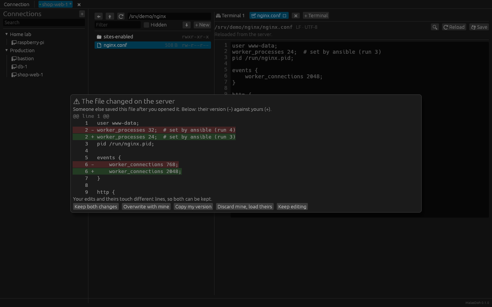

# MalasDoh

A native SSH client for people who log in to servers to patch files and fix
configs. It combines a terminal, an SFTP file browser and an editor in one
window, and it is careful about the one thing that matters most when you edit
a file on a live server: **not breaking it**.

Written in Rust. One binary for Windows, Linux and macOS, with no Electron, no
browser engine and no PuTTY/OpenSSH runtime dependency.


## Why another SSH client

electerm, WinSCP and Termius each do part of this well. MalasDoh focuses on the
remote-editing loop, where they are weakest:

| When you save a remote file… | MalasDoh |
| --- | --- |
| Do you see what you changed? | A diff is shown before writing (can be turned off). |
| Did someone else change it meanwhile (a colleague, Ansible, a deploy)? | The file is re-read first. If it changed, nothing is written; you get their version vs yours, and **if the edits touch different lines you can keep both** (three-way merge). |
| Can you undo it? | The previous contents are always backed up on your computer (optionally also as `file.bak-<time>` on the server). Any backup can be restored, through the same diff review. |
| Does it keep owner, group, mode, hard links, SELinux labels? | Yes. The file is rewritten in place, not replaced. |
| Does it keep CRLF line endings, a BOM, a missing final newline? | Yes, byte for byte on the lines you did not touch. |
| Did the write actually land? | The file is read back after saving and must match. |
| The file is owned by root? | "Edit as root (sudo)", or "Save as root" when a save hits *Permission denied*. |



## Features

- **Connections**: saved profiles with groups and search; jump hosts
  (ProxyJump) with chains; import from `~/.ssh/config`; duplicate; copy as an
  `ssh` command.
- **Authentication**: SSH agent (OpenSSH agent and Pageant on Windows,
  `SSH_AUTH_SOCK` elsewhere), key files (OpenSSH, PEM, **PuTTY `.ppk`**,
  encrypted or not), password and keyboard-interactive (including OTP prompts).
  Passwords and key passphrases are only stored if you tick "remember", and
  then in the OS keychain (Windows Credential Manager, macOS Keychain, Secret
  Service), never in MalasDoh's files.
- **Host keys**: checked against your existing `~/.ssh/known_hosts` (so hosts
  you trust in `ssh` are trusted here) and MalasDoh's own file. A new host shows
  its SHA256 fingerprint for you to confirm. A *changed* or `@revoked` key is
  refused outright and never offered as "accept anyway".
- **Terminal**: xterm-256color and truecolor, full-screen programs (vim, nano,
  htop, less), scrollback, selection and copy, bracketed paste, several
  terminals per connection. Ctrl+C copies when text is selected and interrupts
  otherwise.
- **File browser**: navigate, filter, hidden files, upload (button or drag and
  drop from the desktop) and download (files or whole folders, with progress and
  cancel), new file/folder, rename, delete, chmod, copy path, "cd here in
  terminal".
- **Editor**: line numbers, find, Ctrl+S, and the save safety above. Or open
  the file in your own editor (VS Code, Notepad++, vim…): each save there is
  uploaded with the same checks.
- **Resilience**: a dropped connection is detected; open files keep your
  unsaved edits, and Reconnect picks up where you were.
- **Portable mode**: put a file named `malasdoh.portable` next to the
  executable and everything (profiles, known hosts, backups) is kept in a
  `data` folder beside it.

## Building

You need a recent stable Rust toolchain (1.89 or newer).

```sh
cargo build --release
# the app:
./target/release/malasdoh        # malasdoh.exe on Windows
```

Linux needs the usual desktop libraries at run time (X11 or Wayland, OpenGL,
`libxkbcommon`); every desktop distribution has them.

## Where things are kept

| What | Where |
| --- | --- |
| Profiles | `profiles.toml` in the config directory (`%APPDATA%\MalasDoh\config`, `~/.config/malasdoh`, `~/Library/Application Support/MalasDoh`) |
| Settings | `settings.toml` beside it |
| Host keys you accepted | `known_hosts` in the data directory (`~/.ssh/known_hosts` is read but never written) |
| Backups of edited files | `backups/<host>/<remote path>/<file>.<UTC time>` in the data directory, owner-only permissions |

Settings → shows the exact paths. `MALASDOH_HOME=/some/dir` overrides all of
them.

## Project layout

- `crates/malasdoh-core`: everything that touches the network or disk.
  Profiles, `known_hosts`, SSH connect/auth (on [`russh`](https://github.com/warp-tech/russh),
  pure Rust), SFTP, the safe-edit logic, diff and three-way merge. No GUI code.
- `crates/malasdoh`: the [egui](https://github.com/emilk/egui) desktop app.

## Tests

```sh
cargo test --workspace
```

`crates/malasdoh-core/tests/sshd.rs` starts a real OpenSSH `sshd` on a free
local port (throwaway keys, nothing on the machine is touched) and checks the
whole path end to end: host-key trust and refusal, passphrase retry and
remember, jump hosts, shell, exec, SFTP transfers, safe save, conflict
detection, CRLF and permission preservation, and sudo editing. If `sshd` is not
installed those tests are skipped; CI installs it.

See [`docs/roadmap.md`](docs/roadmap.md) for what is planned next.
